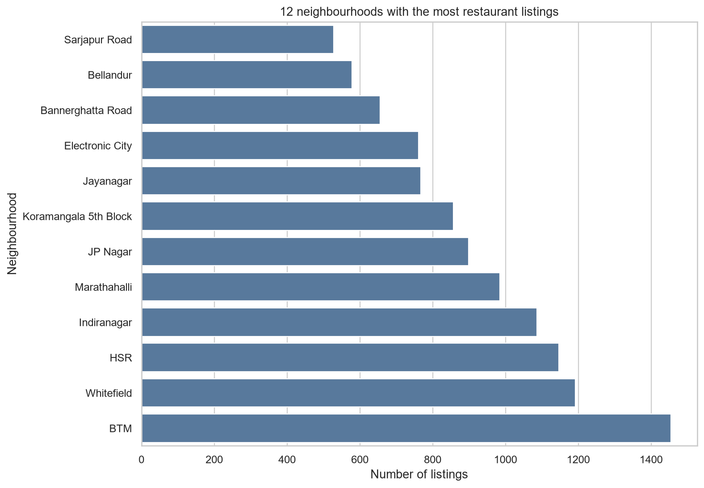
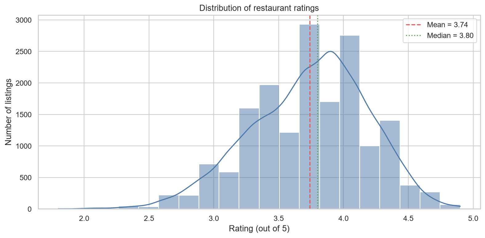
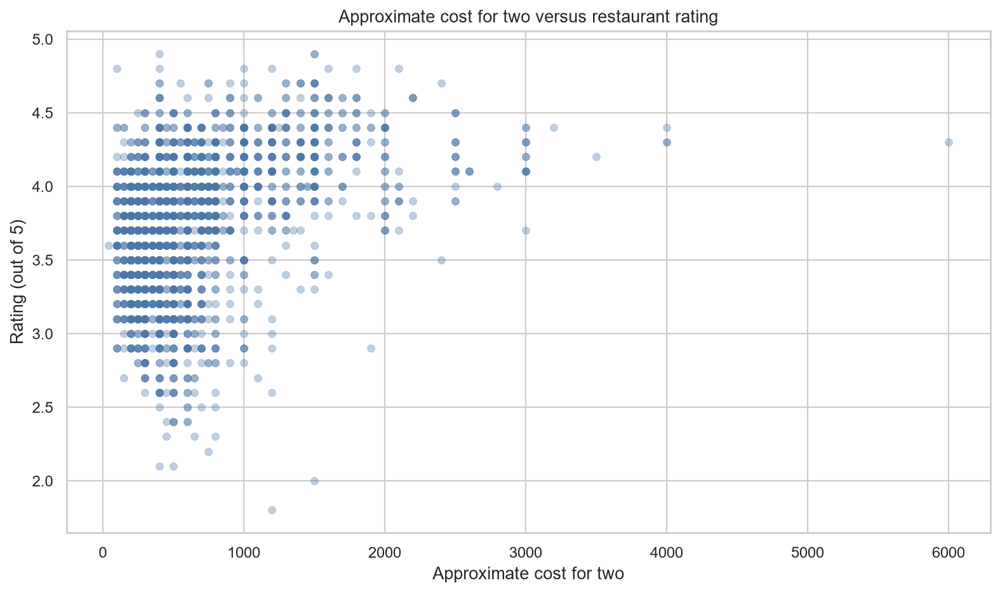

# Zomato Bengaluru Restaurant Data Analysis

### Python | Pandas | NumPy | Matplotlib | Seaborn

An exploratory data analysis of Bengaluru restaurant listings using Python. This project focuses on data cleaning, exploratory analysis, statistical relationships and visualisation to uncover patterns in restaurant distribution, customer ratings, pricing and service availability.

---

## Project Overview

This project analyses the Zomato Bengaluru restaurant dataset to understand the restaurant landscape through structured data exploration.

The analysis follows a complete data-analysis workflow, from inspecting and cleaning raw data to transforming variables, investigating patterns and communicating findings through visualisations.

The emphasis is on understanding real-world data, making appropriate analytical decisions and interpreting results without overstating what the data can prove.

## Objectives

- Clean and prepare a real-world restaurant dataset.
- Handle missing values, inconsistent formats and duplicate records.
- Explore restaurant distribution across Bengaluru neighbourhoods.
- Investigate rating patterns and restaurant characteristics.
- Examine relationships between approximate pricing and ratings.
- Compare recorded online-order and table-booking availability.
- Explore restaurant types and cuisine preferences.
- Communicate findings through statistical summaries and visualisations.

## Dataset

**Source:** [Zomato Bangalore Restaurants – Kaggle](https://www.kaggle.com/datasets/himanshupoddar/zomato-bangalore-restaurants)

The original dataset contains 51,717 rows and 17 columns.

The CSV is not included in this repository. Refer to `data/raw/README.md` for instructions on obtaining and placing the dataset locally.

## Data Cleaning and Preparation

The notebook performs the following operations:

- Inspects dataset dimensions, column names, data types and missing values.
- Removes fields outside the selected analytical scope, including URLs, contact details and review text.
- Converts restaurant ratings into numeric values on a scale of 0–5.
- Converts approximate cost for two people into numeric values.
- Standardises online-order and table-booking availability into Yes, No and Unknown.
- Identifies and removes duplicate records using the retained analytical columns.
- Separates multiple cuisine entries into individual cuisine tags.
- Retains missing numeric values in the cleaned dataset and excludes them only from analyses requiring those values.

After selecting the analytical columns and applying the cleaning and duplicate-removal process, 20,627 records remained.

## Analysis Performed

The project investigates:

1. Restaurant listing distribution across neighbourhoods.
2. Restaurant rating distribution.
3. Most frequently occurring restaurant types and cuisine tags.
4. Rating comparisons based on online-order availability.
5. Rating comparisons based on table-booking availability.
6. Relationship between approximate cost and restaurant ratings.
7. Rating patterns across approximate price bands.
8. Cost differences based on table-booking availability.
9. Restaurant types with higher average ratings, subject to minimum sample-size requirements.
10. Neighbourhoods with higher average ratings, subject to minimum sample-size requirements.
11. Vote distribution across rating bands.
12. Online-order availability across neighbourhoods.

## Key Findings

The executed analysis produced the following results:

| Metric | Result |
|---|---:|
| Original dataset records | 51,717 |
| Records after analytical cleaning | 20,627 |
| Listings with valid ratings | 17,161 |
| Listings with approximate cost | 20,501 |
| Listings with both rating and cost | 17,081 |
| Most represented neighbourhood | BTM (1,454 listings) |
| Mean restaurant rating | 3.74 / 5 |
| Median restaurant rating | 3.80 / 5 |
| Pearson cost-rating correlation | 0.407 |
| Spearman cost-rating correlation | 0.425 |

### Interpretation

- The mean and median ratings indicate that the recorded ratings are centred around the upper-middle portion of the 0–5 scale.
- BTM has the largest representation in the cleaned analytical dataset.
- Both Pearson and Spearman correlations indicate a positive association between approximate cost and restaurant ratings.
- These relationships are descriptive and do not establish that higher prices cause higher ratings.

## Visualisations

The notebook generates 12 visualisations and saves them in `outputs/visualizations/`.

### Restaurant Distribution



### Rating Distribution



### Cost and Rating Relationship



## Technologies Used

- **Python** – Programming and analysis.
- **Pandas** – Data manipulation, cleaning and aggregation.
- **NumPy** – Numerical operations.
- **Matplotlib** – Data visualisation.
- **Seaborn** – Statistical visualisation.
- **SciPy** – Statistical dependency for correlation calculations.
- **Jupyter Notebook** – Interactive analysis environment.

## Project Structure

```text
zomato-restaurant-analysis/
│
├── README.md
├── requirements.txt
├── .gitignore
│
├── notebooks/
│   └── zomato_eda.ipynb
│
├── data/
│   └── raw/
│       └── README.md
│
├── outputs/
│   └── visualizations/
│
└── docs/
    ├── data_dictionary.md
    └── data_source_and_license.md
```

## How to Run the Project

### 1. Clone the repository

```bash
git clone https://github.com/Abhiram-Reddy434/zomato-restaurant-analysis.git
cd zomato-restaurant-analysis
```

### 2. Install dependencies

```bash
pip install -r requirements.txt
```

### 3. Obtain the dataset

Download the dataset from the Kaggle source listed above.

Place the CSV in:

```text
data/raw/zomato.csv
```

### 4. Run the notebook

Open:

```text
notebooks/zomato_eda.ipynb
```

Run all cells in Jupyter Notebook or VS Code.

The notebook will perform the analysis and generate the visualisations in the output directory.

## Documentation

- [Data Dictionary](docs/data_dictionary.md)
- [Data Source and Licence](docs/data_source_and_license.md)
- [Raw Dataset Instructions](data/raw/README.md)

## Limitations

- The dataset represents a historical snapshot rather than current restaurant conditions.
- Missing values may affect individual analyses.
- Duplicate removal is based on retained analytical columns and may collapse listings that match on those fields.
- Approximate cost is not an exact measure of actual customer spending.
- Cuisine tags are multi-label, so cuisine occurrence counts can exceed the number of restaurant listings.
- Correlation and group comparisons do not establish causation.

## Conclusion

This project demonstrates a practical exploratory data analysis workflow using Python and its data-analysis ecosystem. It combines data cleaning, numerical analysis, statistical relationships and visualisation to investigate patterns in Bengaluru's restaurant listings.
